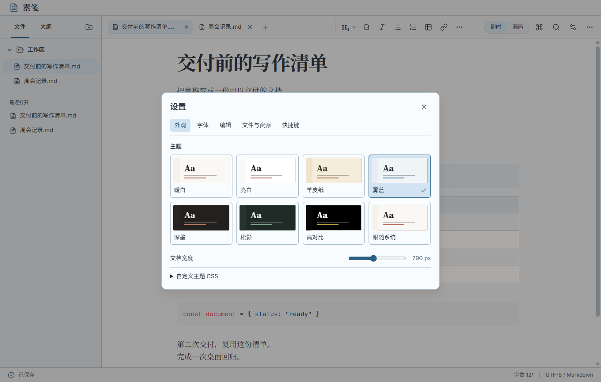
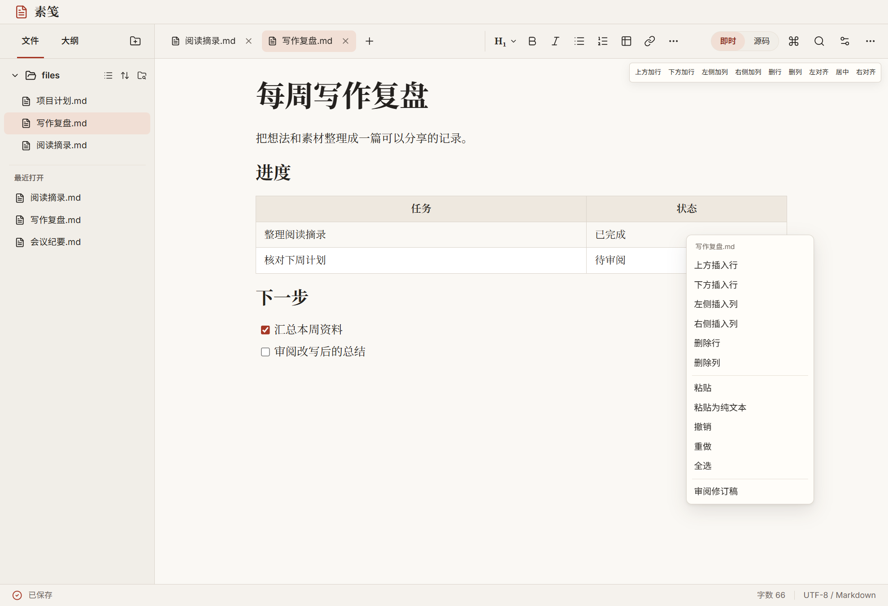
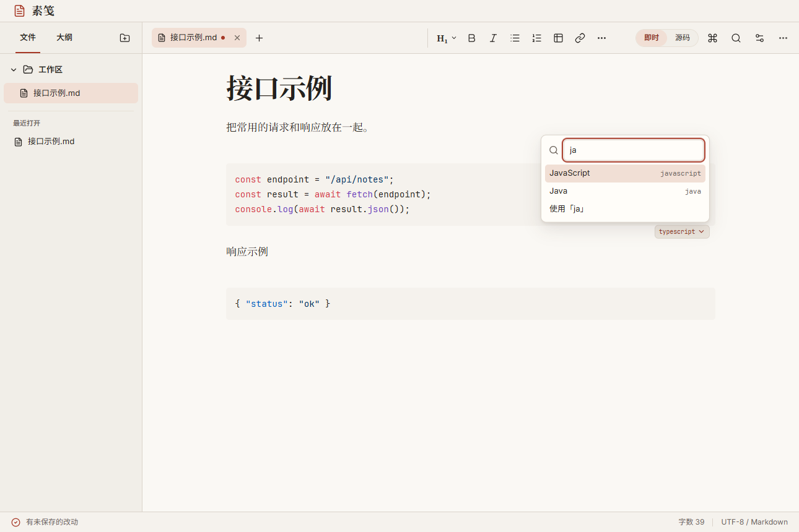
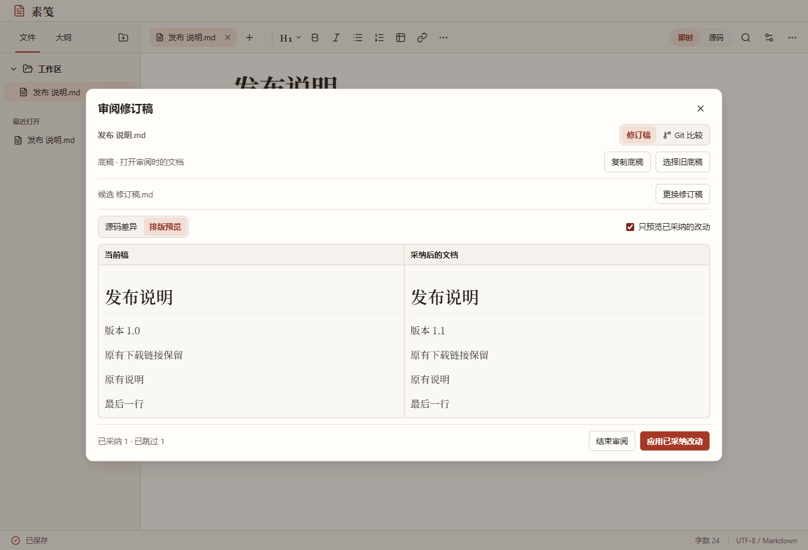
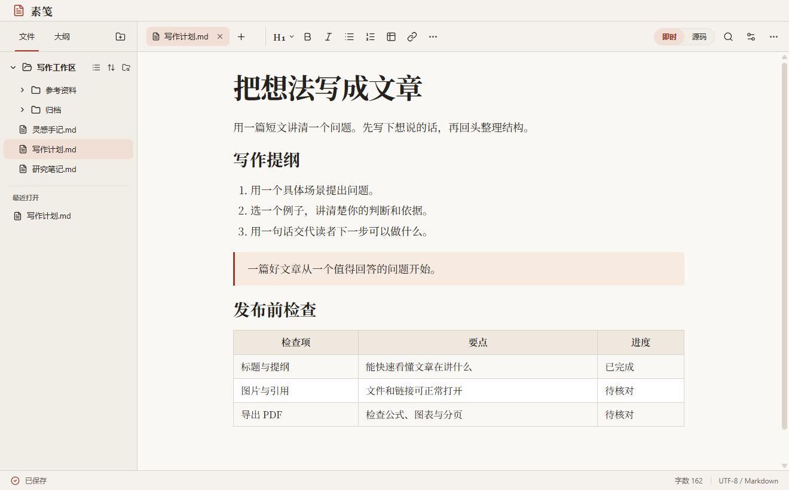
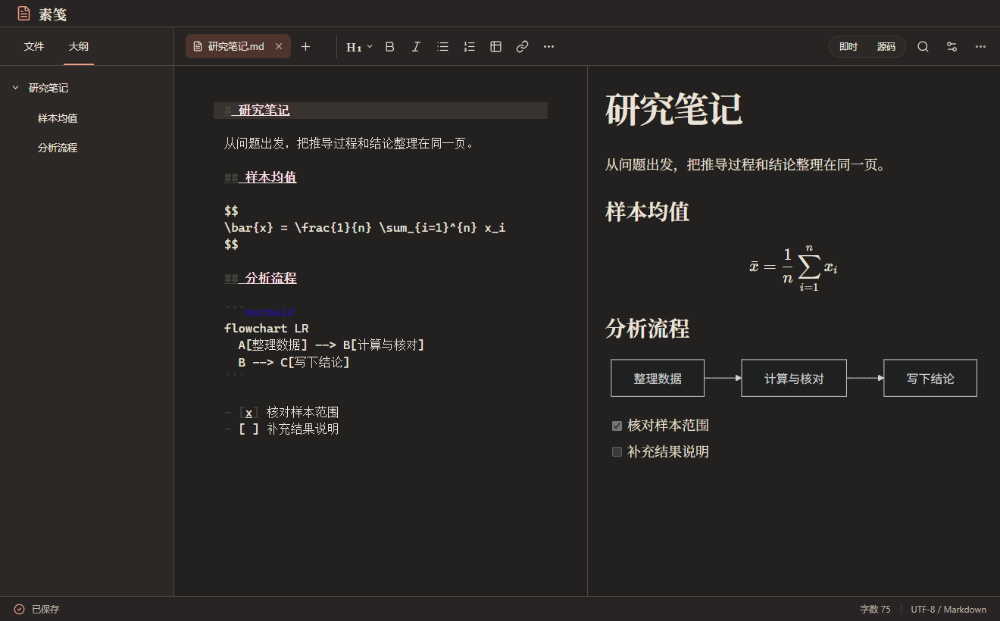

<p align="center">
  
</p>

<h1 align="center">素笺 Sujian</h1>

<p align="center"><strong>写作时看见排版，改稿时看清变化。</strong></p>
<p align="center">给长文、技术文档和改稿用的本地 Markdown 编辑器。边写边看排版，用键盘找到文件和命令，再把确认过的改动交付出去。</p>
<p align="center"><a href="https://github.com/peterwangze/sujian-markdown/releases/tag/v1.3.0"><strong>下载 v1.3.0 离线安装包</strong></a> · Windows / macOS / Linux</p>

## 用顺手的方式写作



- **给不同的写作环境换一套配色。** 在 **设置 → 外观** 直接预览暖白、亮白、羊皮纸、雾蓝、深墨、松影和高对比。配色同时应用到编辑、阅读和审阅界面，也可跟随系统切换或导入 CSS。
- **长文和代码用各自合适的字。** 在 **设置 → 字体** 分别选正文与标题、源码与代码、菜单与界面的字体。调整字号、行距时可就地看样张。内置 Inter、Source Serif 4、JetBrains Mono、Noto Sans SC 和 Noto Serif SC，断网也能用，均随应用附带 SIL Open Font License。在同一页可导入 TTF、OTF、WOFF 或 WOFF2，字体保存在本机的素笺字体库，供本机编辑与阅读使用。
- **从键盘直达文件、命令和行号。** `Ctrl/⌘+P` 按文件名或路径打开，`Ctrl/⌘+Shift+P` 搜索命令，`Ctrl/⌘+G` 跳到源码指定行。`Ctrl+Tab` 与 `Ctrl+Shift+Tab` 切换标签，`F3` 与 `Shift+F3` 在查找栏打开时浏览匹配。可以在 **设置 → 快捷键** 搜索命令、直接按键录入、查看冲突和恢复默认。
- **少一次伸手拿鼠标。** 文件侧栏可用方向键在条目间移动、展开和折叠目录。工具菜单支持方向键选择和 `Esc` 返回。在标签栏用 `Delete` 关闭文件后，可以接着用方向键操作剩余标签。
- **写到列表项中间也能调整层级。** 用 `Tab` 和 `Shift+Tab` 缩进或提升普通列表、编号和任务项。可一次移动同级选中的多项，也可调整选中的多行代码。表格仍可前后移格，末格按 `Tab` 接着填新行。先按 `Esc` 再按 `Tab` 或 `Shift+Tab` 可移出编辑区。[编辑按键行为](docs/usability.md#正文编辑按键)

## 在要操作的地方右击



- **编辑时少走一步。** 右击选中的文字即可复制、剪切或改格式；右击表格可增删行列，右击代码块可复制代码或更改语言，右击链接可打开或复制地址。正文菜单也能打开当前文档的修订审阅。
- **在文件列表里直接审阅。** 右击侧栏文件、最近文档或标签页，选择 **审阅修订稿**。目标文档可以在后台打开，你仍可留在正在写的标签页。用键盘聚焦目标后，也可按 `Shift+F10` 打开菜单。
- **在代码旁选择高亮语言。** 在即时编辑中点击代码块右下角的语言标签，输入 `py`、`ts` 等别名，用方向键和回车选择。也可选纯文本或输入自己的语言标记。



## 写技术文档、审改稿、交付定稿

- **审一份 AI 改过的发布说明。** 把候选稿放进素笺，查看源码增删和排版效果。保留原来的下载链接，只采纳核实过的改动。仓库文档还可以和本机 Git 版本做只读对照。
- **让规格、任务和验收证据对得上。** 用「规格与验收」模板建立一组普通 Markdown 文件。打开相关文档后，在 **文档与视图 → 检查规格与验收** 中查找重复编号、未关联的需求、找不到的验收项和缺少证据链接的任务。
- **把会议结论整理成可核对的跟进稿。** 用「纪要与跟进」模板记录决定、负责人和截止日期。给结论附上已保存文档的相对来源链接，在阅读或分栏预览中点击即可跳到原文行。确认后可导出 Word 或 PDF。

## 和现有 AI 工具一起使用



*审阅发布说明时，可以只采纳版本号变更，保留原有下载信息。截图来自 Windows 客户端。*

1. 打开原文，选择 **文档与视图 → 审阅修订稿 → 复制底稿**。用你习惯的 AI 工具改稿，再粘贴完整候选稿或选取文件。候选稿基于更早的版本时，使用 **选择旧底稿**。
2. 在源码差异里逐处采纳或跳过。打开 **排版预览 → 只预览已采纳的改动**，确认应用后的效果。有重叠修改时，界面会并列显示底稿、当前稿和候选稿。
3. 应用后继续编辑、保存或导出。改动先进入当前文档，并沿用已有保存设置。文档内容尚未再次变化时，可以选择 **文档与视图 → 撤销本次审阅**。

AI 生成由你选择的外部工具完成。素笺在本机进行审阅、比较与导出。涉及外部媒体和自定义图表配置的改动可在源码差异中核对。

## 从第一行写到交稿



- **输入时就看到正文效果。** 标题、任务列表和表格随输入呈现。可以切换到源码、分栏预览和阅读模式。写长文时可调整正文宽度，并开启专注或打字机模式。
- **把多份文档放在手边。** 用标签页切换文件，从大纲跳到章节，在工作区里跨文件搜索。长文档自动进入源码模式，便于滚动和查找。
- **保住正在写的内容。** 重启后可以从侧栏恢复未保存的草稿。磁盘文件有外部改动时，可以对照磁盘版本，并把正在编辑的内容另存成副本。
- **断网也能导出成品。** 本地公式和 Mermaid 图表可离线渲染。安装包内置 Pandoc，支持 PDF、HTML、PNG 长图、Word、EPUB 和 Reveal.js 幻灯片等格式。



## 从 Git 和终端进入素笺

安装本机 Git 后，可在已打开的仓库文档中使用 **Git 比较**，读取 `HEAD`、分支、标签或提交版本作对照。外部工具也可以直接打开文档的指定行，或把候选稿交给审阅界面。以下以 Linux DEB 为例。

```sh
/opt/Sujian/sujian open "docs/验收记录.md" --line 12
/opt/Sujian/sujian review "CHANGELOG.md" --candidate "候选 发布说明.md"
```

Windows 使用安装目录中的 `Sujian.exe`。macOS 使用 `/Applications/Sujian.app/Contents/MacOS/Sujian`。Linux AppImage 可直接传入相同的参数。

## 下载与安装

| 系统 | x64 / Intel | ARM64 / Apple 芯片 |
| --- | --- | --- |
| Windows | [EXE](https://github.com/peterwangze/sujian-markdown/releases/download/v1.3.0/Sujian-1.3.0-win-x64.exe) | [EXE](https://github.com/peterwangze/sujian-markdown/releases/download/v1.3.0/Sujian-1.3.0-win-arm64.exe) |
| macOS 13+ | [DMG](https://github.com/peterwangze/sujian-markdown/releases/download/v1.3.0/Sujian-1.3.0-mac-x64.dmg) | [DMG](https://github.com/peterwangze/sujian-markdown/releases/download/v1.3.0/Sujian-1.3.0-mac-arm64.dmg) |
| Linux | [AppImage](https://github.com/peterwangze/sujian-markdown/releases/download/v1.3.0/Sujian-1.3.0-linux-x86_64.AppImage) · [DEB](https://github.com/peterwangze/sujian-markdown/releases/download/v1.3.0/Sujian-1.3.0-linux-amd64.deb) | [AppImage](https://github.com/peterwangze/sujian-markdown/releases/download/v1.3.0/Sujian-1.3.0-linux-arm64.AppImage) · [DEB](https://github.com/peterwangze/sujian-markdown/releases/download/v1.3.0/Sujian-1.3.0-linux-arm64.deb) |

- **Windows** 双击 EXE 安装。安装包未做 Authenticode 签名。ARM64 版的 Pandoc 使用 Windows 11 的 x64 仿真。
- **macOS** 挂载 DMG 后，将素笺拖到“应用程序”。此版本采用临时签名，首次启动时可能需要在“隐私与安全性”中允许打开。[Apple 打开应用说明](https://support.apple.com/en-us/102445)
- **Linux** 赋予 AppImage 执行权限后打开，或通过软件包管理器安装 DEB。运行依赖发行版提供的 Chromium 系统库。

安装包包含应用运行时、渲染资源、字体与 Pandoc。六种系统与架构组合均通过成品启动检查。[SHA-256 清单](https://github.com/peterwangze/sujian-markdown/releases/download/v1.3.0/SHA256SUMS.txt) · [构建与验证记录](https://github.com/peterwangze/sujian-markdown/actions/workflows/release.yml)

## 开发与兼容范围

使用 Node.js 24。

```sh
npm ci
npm run build
npm start
```

运行 `npm test` 执行自动化回归。使用 `npm run package -- win32 x64` 构建 Windows x64 离线安装包，也可指定 `darwin` 或 `linux` 和对应架构。

用户可见的特性与 README 在同一次变更中更新。[开发规范](AGENTS.md)

素笺以 Typora 1.14.x 的公开功能为调研基线。传统编码、MathJax 扩展、多版本历史和部分系统集成仍有兼容差异。[功能对照与验收记录](docs/compatibility.md)

[操作与外观调研](docs/usability.md) · [内置字体与授权](public/fonts/README.md)
