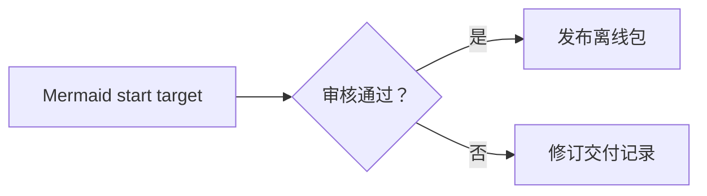
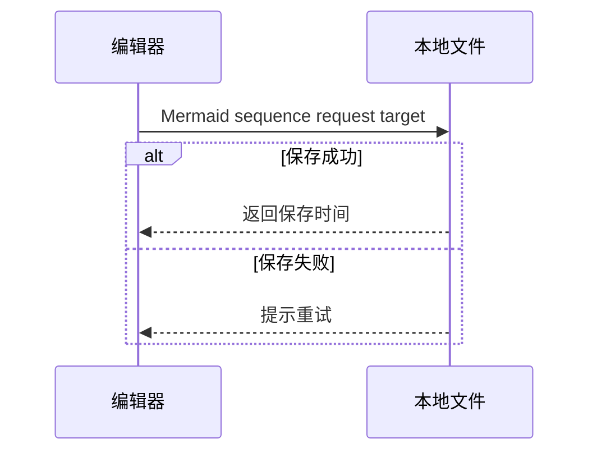
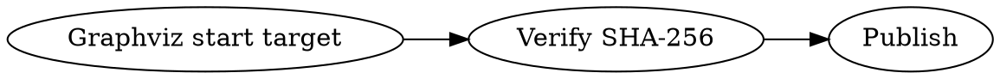
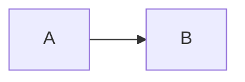

# Markdown 格式验收样例

这份文档以交付手册、项目 README、个人知识库和研究报告为场景。使用 Markdown 文件直接打开样例，分别检查实时编辑、预览和需要验收的导出格式。将光标移到其他段落后观察实时渲染，切回源码确认原始标记和内容仍可编辑。检查本地图片时保留文件相对目录。

**判定依据。** CommonMark 和 GFM 章节按各自规范核对。GitHub、Typora、Obsidian、Pandoc、Quarto 章节按对应产品的文档核对，使用相关扩展时记录设置或运行环境。未启用或尚未实现的扩展应保留可读的原文，且后续内容应继续渲染。

**记录结果。** 对每项记录所用模式和设置、实际渲染、链接或控件是否能操作，以及保存重开后标记是否完整。导出时按目标格式的能力核对可读内容和结构。最后确认文末标记可见。

[TOC]

## CM-BLOCKS

交付手册需要可导航的层级、可续写的清单和能复制的命令。首段标题使用 ATX 语法，下面的 Setext 标题以横线定义层级。预期有序列表从 7 开始，嵌套事项仍归属于第 7 项，引用中的清单仍留在引用内。 [CommonMark 块级语法](https://spec.commonmark.org/0.31.2/#blocks-and-inlines)

交付前检查（Setext 二级标题）
----------------------------

### 部署安排

#### 责任人

##### 交接时间

###### 补充记录

7. 核对下载地址。
   - 打开离线安装说明。
   - 记录校验文件。
8. 通知支持团队。

> 发布窗口为星期四。
>
> > 值班同事已确认交接。
>
> - 保留上一版安装包。
> - 记下恢复步骤。

* * *

下面是缩进代码块。预期保留内部换行，代码中的井号为字面内容。

    # 逐行记录校验结果
    status = "ready"

下面是带语言标识的围栏代码块。预期保留原文、引号和空白，可单独复制。

```json
{
  "release": "2026-11",
  "offline": true
}
```

## CM-INLINE

项目记录使用粗体标识状态、斜体标识例外、行内代码标识参数。预期斜体可嵌套在粗体内，反引号里的星号保持原样，实体解码后显示实际字符。 [CommonMark 行内语法](https://spec.commonmark.org/0.31.2/#inlines)

请先阅读 **CM emphasis target**，其中 *需要复核*，交付前 **确认 *全部平台***。也可使用 __备用粗体__ 和 _备用斜体_。

中文紧邻格式标记时，分别核对这里的*斜体*和这里的**粗体**。构建参数为 `--offline`，检索模式是 `build-*.zip`，包含反引号的文本可以写成 ``printf '`'``。

这里的 \*星号\*、\_下划线\_ 和 \[方括号\] 都应按字面显示。实体示例为 A &amp; B、&#169; 和 &#x2713;。

## CM-LINKS

发布指南同时使用相对链接、段内导航、带标题的引用式链接和本地图像。预期完整、折叠和简写引用均能定位定义，定义本身不形成正文段落；相对图片载入后显示实际内容，加载不到时能保留替代文字。文内标题跳转同时检查目标产品的标题锚点规则。 [CommonMark 链接](https://spec.commonmark.org/0.31.2/#links) · [CommonMark 图片](https://spec.commonmark.org/0.31.2/#images) · [GitHub 标题与相对链接](https://docs.github.com/en/get-started/writing-on-github/getting-started-with-writing-and-formatting-on-github/basic-writing-and-formatting-syntax#relative-links)

- [查看仓库 README](../README.md "仓库中的项目说明")
- [跳到格式兼容性样例](#dialects)
- [GFM 标题锚点](#release-review-v13)、[GFM 重复标题锚点](#release-review-v13-1)和[显式命名锚点](#qa-manual-anchor)
- [核对标准][cm-reference]、[快捷指引][]、[源码资料]
- [带空格路径解析样例](<./Release Notes.md> "检查链接地址的转义，示例文件未提供")
- 规范链接 <https://spec.commonmark.org/> 和邮箱链接 <qa@example.org>。


![CM reference image target][local-icon]

[cm-reference]: https://spec.commonmark.org/0.31.2/ "CommonMark 0.31.2"
[快捷指引]: ./usability.md
[源码资料]: ../README.md
[local-icon]: ../build/icon.png "引用式本地验收图标"

### Release Review v1.3

CM canonical heading target

### Release Review v1.3

CM duplicate heading target

<a name="qa-manual-anchor"></a>

### 手工锚点

CM explicit anchor target

## CM-BREAKS

在发布公告中，普通换行连接同一段话，硬换行保留地址或诗行的分行。预期软换行仍位于同一段落，其实际视觉换行取决于渲染配置和可用行宽。行末反斜杠或两个 ASCII 空格与下一行紧邻时应产生显式换行。 [CommonMark 硬换行](https://spec.commonmark.org/0.31.2/#hard-line-breaks) · [CommonMark 软换行](https://spec.commonmark.org/0.31.2/#soft-line-breaks)

CM soft break first
CM soft break second

CM hard break first\
CM hard break second

CM two-space break first  
CM two-space break second

CM paragraph separation target

## CM-HTML

运维手册用键帽和折叠详情压缩辅助信息。CommonMark 识别原始 HTML，具体应用按自身 HTML 处理策略呈现。允许以下静态标签时，应可点击折叠标题并看到详情，HTML 注释不应成为可见正文。 [CommonMark HTML 块](https://spec.commonmark.org/0.31.2/#html-blocks) · [GFM 禁止的原始 HTML](https://github.github.com/gfm/#disallowed-raw-html-extension-) · [Typora HTML](https://support.typora.io/Markdown-Reference/#html)

按 <kbd>Ctrl</kbd> + <kbd>S</kbd> 保存。<u>CM underline target</u>、H<sub>2</sub>O、m<sup>2</sup> 和 <mark>CM HTML highlight target</mark> 均由静态 HTML 元素定义。

<details>
<summary>CM details summary target</summary>
<p>CM details content target</p>
</details>

<!-- CM hidden comment target -->

CM after HTML target

## GFM-COLLAB

团队 README 用清单同步任务，用表格比较平台。预期任务有选中和未选中两种状态，表头以下的单元格按左、中、右对齐，表内转义竖线留在单元格里，删除线覆盖废弃内容，裸链接与邮箱可识别为链接。 [GFM 规范](https://github.github.com/gfm/)

- [x] GFM task done
- [ ] GFM task open
  - [X] GFM nested task done
  - [ ] GFM nested task open

| 项目 | 状态 | 大小（MB） |
| :--- | :---: | ---: |
| GFM table target | **就绪** | 128 |
| Windows \| macOS | `offline` | 256 |
| 备用命令 | `a\|b` | 64 |

发布内容移除了 ~~过期下载地址~~。核对裸链接 https://example.org/releases 、 www.example.org/download 和 qa@example.org 的目标。

## GITHUB-WRITING

迁移说明用警示区分建议、必要条件和风险。预期五种类型各有对应标题和清晰的正文边界，正文里的强调及行内代码继续渲染。脚注应有可定位的编号、定义和返回入口，定义中的内联格式仍生效。 [GitHub 警示块](https://docs.github.com/en/get-started/writing-on-github/getting-started-with-writing-and-formatting-on-github/basic-writing-and-formatting-syntax#alerts) · [GitHub 脚注](https://docs.github.com/en/get-started/writing-on-github/getting-started-with-writing-and-formatting-on-github/basic-writing-and-formatting-syntax#footnotes)

> [!NOTE]
> GITHUB alert note，离线包已包含应用文件。

> [!TIP]
> GITHUB alert tip，先用 **临时工作区** 核对导入结果。

> [!IMPORTANT]
> GITHUB alert important，升级前保存当前文档。
>
> 保留 `backup.md` 以便回看。

> [!WARNING]
> GITHUB alert warning，旧版本生成的缓存需要重新建立。

> [!CAUTION]
> GITHUB alert caution，删除工作目录前请完成备份。

验收记录的原始依据见此脚注[^evidence]，平台差异另有说明[^platforms]。同一依据可在结论再次引用[^evidence]。

[^evidence]: Footnote evidence target，使用 **本地样例** 保存结果。
[^platforms]: Footnote platform target，记录系统、版本和模式。

## DOCUMENT-EXT

知识库和长文档会用前置元数据、目录、颜色强调、上下标和表情。启用相应扩展时，文首 YAML 应被识别为元数据，目录应随标题变化并可导航，高亮应覆盖标记范围，上下标应保留基线差异，受支持的表情短码应显示为对应表情。YAML 在文件开头，目录位于正文开头。 [Typora Markdown 参考](https://support.typora.io/Markdown-Reference/) · [Obsidian 基本格式](https://help.obsidian.md/syntax) · [Pandoc 元数据块](https://pandoc.org/MANUAL.html#extension-yaml_metadata_block)

这一句包含 ==DOC highlight target==、H~2~O、m^2^、<u>DOC underline target</u>、:tada: 和 :white_check_mark:。

如果所用工具提供这些扩展开关，可在两种状态下打开同一文件，分别检查排版和源码是否完整。

## MATH

技术报告中，行内公式应随正文基线排版，块公式应独立显示，并保留根式、分数、上下限和多行对齐。价格中的美元符号和行内代码中的美元分隔符应保持字面含义。GitHub 也提供带 `math` 语言标识的围栏及另一种行内分隔方式。 [GitHub 数学表达式](https://docs.github.com/en/get-started/writing-on-github/working-with-advanced-formatting/writing-mathematical-expressions) · [Typora 数学块](https://support.typora.io/Markdown-Reference/#math-blocks) · [Pandoc 数学语法](https://pandoc.org/MANUAL.html#math)

MATH inline target 的均值为 $\bar{x}=\frac{1}{n}\sum_{i=1}^{n}x_i$。该工具的价格是 \$15，命令参数写作 `$RATE`。

$$
\begin{aligned}
f(x) &= \sqrt{x^2+1} \\
f'(x) &= \frac{x}{\sqrt{x^2+1}}
\end{aligned}
$$

下面一行使用 GitHub 的美元符号与反引号组合分隔符。

MATH GitHub inline target $`\sqrt{x^2+1}`$。

```math
\int_0^1 x^2\,\mathrm{d}x = \frac{1}{3}
```

## DIAGRAMS

工程交付会把流程、交互和依赖关系作为可维护的文本。启用相应渲染器后，应看到带标签的节点或参与者、正确的连接方向、分支或消息。源码模式与再次打开时应保留代码围栏与内部缩进。 [GitHub Mermaid 图表](https://docs.github.com/en/get-started/writing-on-github/working-with-advanced-formatting/creating-diagrams#creating-mermaid-diagrams) · [Typora 图表](https://support.typora.io/Draw-Diagrams-With-Markdown/) · [Graphviz DOT 语法](https://graphviz.org/doc/info/lang.html)

### Mermaid 审核流程

预期有审核分支和发布、返工两条路径。



### Mermaid 消息时序

预期两个参与者之间有请求、回执和重试分支。



### Flowchart.js 流程

Typora 公开示例使用 `flow` 围栏。预期显示开始、审核、结束三个节点。

```flow
st=>start: Flowchart start target
op=>operation: Verify checksum
e=>end: Release

st->op->e
```

`flowchart` 是另一个可单独验收的围栏标识。两处都采用 Flowchart.js 语法，分别记录渲染结果。

```flowchart
st=>start: Flowchart alias start target
op=>operation: Copy package
e=>end: Done

st->op->e
```

### JS Sequence 时序

预期编辑器发送写入请求，本地文件返回结果，并显示右侧注释。

```sequence
Editor->Disk: Sequence request target
Note right of Disk: Verify file hash
Disk-->Editor: Saved
```

### Graphviz 依赖图

下面以 `dot` 标识围栏中的 Graphviz DOT 源码。支持 DOT 渲染时，预期三个节点从左向右排列，并呈现两条有向边。Quarto 用带大括号的 `{dot}` 表示图表单元格。 [Quarto 图表](https://quarto.org/docs/authoring/diagrams.html#graphviz)



一些 Markdown 渲染器使用 `graphviz` 标识。分别核对两种围栏的结果。


### 引用和清单中的 Mermaid

图表也可用于引用中的决策记录和列表中的发布步骤。预期每幅图仍在原有容器内，紧接着的普通文本应保持相应的引用或清单层级。

> 上次交接记录附有恢复步骤。
>
> ```mermaid
> flowchart LR
>     quote["Nested quote diagram target"] --> restore["恢复上一版"]
> ```
>
> CM after nested quote diagram target

1. 执行发布检查。

   ```mermaid
   flowchart LR
       checklist["Nested list diagram target"] --> archive["归档验收结果"]
   ```

   CM after nested list diagram target
2. 通知维护同事。

## DIALECTS

以下是从知识库和出版项目迁移时遇到的方言。用原工具核对其语义，在通用编辑器中检查识别能力和源码往返。跨笔记链接需要工作区上下文，出版引用需要相应的工具链或参考资料。

### Obsidian 知识库

在包含仓库根目录的 Obsidian 工作区中，第一项可按文件名链接并显示别名，第二项指向本页的块，第三项引用工作区中的图像。启用对应扩展后，提示块显示自定义标题并可折叠。 [Obsidian 内部链接](https://help.obsidian.md/links) · [Obsidian 提示块](https://help.obsidian.md/callouts)

保留下面的交接结论供其他笔记引用。 ^qa-handoff

- [[usability|Obsidian wiki alias target]]
- [[#^qa-handoff|Obsidian block reference target]]
- ![[build/icon.png|Obsidian image embed target]]

> [!tip]- Obsidian collapsible callout target
> 默认收起的附加步骤，展开后可见。

### Pandoc 技术文档

启用 Pandoc 对应扩展时，定义列表应关联术语与释义，内联脚注应生成可定位的注释，属性和围栏 Div 应进入文档结构。此处只示例引用标记的保留，解析引用需提供对应文献条目和引文处理配置。 [Pandoc 的 Markdown](https://pandoc.org/MANUAL.html#pandocs-markdown)

Pandoc definition term target

:   离线包完整性通过摘要值核对。

这里有一则内联说明。^[Pandoc inline footnote target]

::: {#pandoc-container .handoff}
Pandoc fenced div target
:::

### Pandoc heading attribute target {#pandoc-heading}

相关研究见 [@qa-markdown-study]。

下面的围栏属性给代码块设置标识、语言和行号。保留原文时应完整保存大括号内的参数。 [Pandoc 围栏代码属性](https://pandoc.org/MANUAL.html#extension-fenced_code_attributes)

```{#pandoc-code .python .numberLines startFrom="7"}
print("Pandoc fenced code target")
```

### Quarto 研究报告

在 Quarto 项目中用适用的输出格式渲染，图示应带编号，正文引用应指向图示。提示块应有标题及折叠交互。直接用 Markdown 编辑器打开本样例时，还要核对标识符和属性在保存后是否完整。 [Quarto 交叉引用](https://quarto.org/docs/authoring/cross-references.html) · [Quarto 提示块](https://quarto.org/docs/authoring/callouts.html)

从 @fig-qa-icon 可以找到封面图标。

{#fig-qa-icon width="32%"}

::: {.callout-note collapse="true"}
## Quarto callout title target

此说明补充图示来源，读者需要时可以展开。
:::

在配置了 Python 计算环境的 Quarto 项目中，下面的单元格应保留代码和输出。用 Markdown 编辑器检查时，验收语言标识、单元格选项和代码的保存。 [Quarto Python 单元格](https://quarto.org/docs/computations/python.html)

```{python}
#| label: qa-python-cell
#| echo: true
print("Quarto code cell target")
```

## EDGE-FIXTURES

以下组合用来验证解析边界。外层围栏内的 Markdown 应当作为可复制的源码，行内代码中的格式标记应按字面显示，引用中的空行和嵌套清单应保留容器结构。 [CommonMark 围栏代码块](https://spec.commonmark.org/0.31.2/#fenced-code-blocks) · [CommonMark 代码片段](https://spec.commonmark.org/0.31.2/#code-spans)

````markdown
# EDGE fenced Markdown target


````

~~~text
EDGE tilde fence target
[!NOTE] $E=mc^2$ **literal** ==literal==
~~~

中文相邻语法组合：**重点**、*范围*、~~过期~~、==高亮==、`$not_math$ **not_bold**`。

中文顿号紧邻裸链接时，某些解析器会将 https://example.org/old、www.example.org/archive 识别为一个链接。核对源文是否完整，并记录实际链接边界。

> EDGE nested quote target
>
> 1. 读取说明。
>    - 比对当前结果。
> 2. 保存记录。

QA-END
